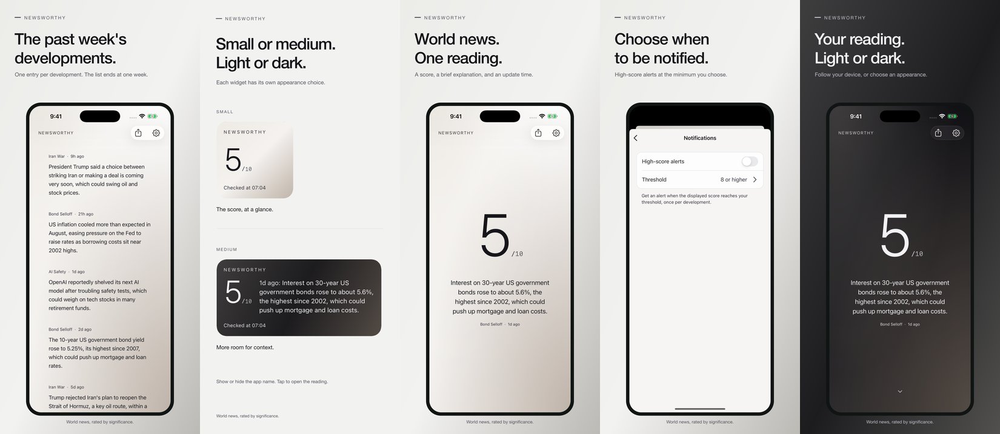
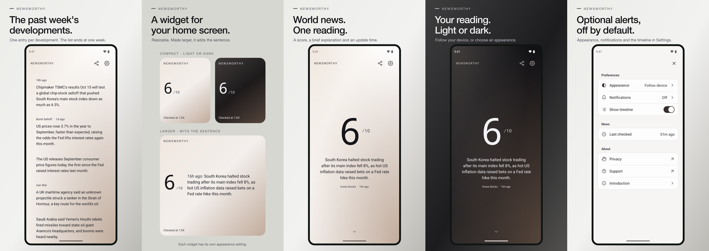

# Newsworthy store release

One place for the mobile listings, artwork, evidence, and remaining work.
Resume from [the release ledger](ledger.md) with the reusable
[app-release skill](https://github.com/astrojams1/skills/tree/main/skills/app-release).

## Current resubmission — 1 October 2026

PR #155 is merged. Its production **1.0.0 (26)** is selected, `VALID` and
`IN_BETA_TESTING`. Apple confirms **Waiting for Review**, read back on
1 October at 11:37 UTC. See [the submission receipt](apple-review-resubmission-2026-10-01-build26.json).
Application source is `51826ed`; later commits change listing copy and records.

The description, promotional text, keywords, URLs and six-part Review Notes
are saved and read back. No public App Store preview video is included. The
physical review recording remains historical build-21 evidence, labeled in
Notes; these simulator captures do not certify build 26 on a physical device.

The final gallery contains **five iPhone and three iPad screenshots**, all read
back `COMPLETE`, in the intended order, with matching checksums. The finite-week
timeline leads both device families. iPhone artwork also shows real small/medium
widgets on a neutral canvas, the reading, the **Notifications page** (alert
switch and threshold row), and dark appearance. The threshold-selector image
and all previous gallery images are retired. No About page is featured.

[Gallery plan](apple-gallery-26.json), [capture provenance](source/ios-gallery-v26-provenance.json),
[upload receipt](apple-gallery26-upload.json), [gallery readback](apple-gallery26-verification.json)
and editable layouts are retained here. The [renderer](scripts/render-apple-gallery.mjs)
uses generated Stone colors and verifies original native captures and measured
widget bounds before composing the artwork. Native text and gradients remain
unchanged. Android's historical artwork stays separately identified.

Six app-screen images were captured on iOS 26.5 in an authorized Expo macOS
sandbox. That sandbox was stopped after 35m13s; its tool connection reached the
500-request cap. One EAS simulator-release build (`78c0ccc8`) then finished and
was downloaded/hash-verified. Its unchanged original artifact rendered Small
Light and Medium Dark widgets, widget settings and the Notifications root page
on the owner's iOS 18.3.1 simulator. Both simulator bundles actually report
1.0.0 (1), with application sources matching production build 26. The sandbox's
AppIntent privilege errors are recorded; signing alone is not an established
cause because the original EAS extension also has empty entitlements and worked
on iOS 18.3.1. Hiding the widget name was not reverified in this capture batch.
The local Mac unlock is resolved. The optional iOS 26.5 runtime download is no
longer a prerequisite for this completed submission.

## Current Google Play artwork — 15 October 2026

The default (en-US) Play listing carries **five phone screenshots, the feature
graphic and the 512 px Stone icon**, uploaded through the Play API and read
back with matching SHA-256 values in order, then confirmed in Play Console.
The listing is saved, not sent for review. See the
[upload receipt](google-play-artwork-15-upload.json).

Every screen comes from Play internal versionCode **15** (`254686f`), its
universal APK installed on an API 35 Pixel 7 emulator: the timeline, the
reading in light and dark, Settings, and the resizable widget at 2×2 (light
and dark) and 4×3 with the sentence, on a neutral wallpaper. Originals,
hashes and limits are in [capture provenance](source/android-phone/provenance-v15.json),
measured widget bounds in [widget frames](source/android-phone/widget-frames-v15.json)
and copy in the [gallery plan](google-play-gallery-15.json). Emulator
captures, not a physical-device check; the sentences are the live readings
of 15 October.

```sh
node store/scripts/render-google-play.mjs
node store/scripts/validate.mjs
node vendor/skills/skills/app-release/scripts/play.mjs status
node vendor/skills/skills/app-release/scripts/play.mjs images
```

The renderer refuses a capture whose hash differs from its provenance record
and retires the September gallery. `upload` replaces the icon, feature graphic
and phone screenshots in one edit and commits only if Play reads back what was
sent; confirm each upload with the owner.

## Historical September release records

The following records describe the earlier submissions and assets. Their
Waiting for Review states are superseded by the current rejection above.

**September 24, 2026 update:** iOS **1.0.0 (21)** is **Waiting for Review**,
confirmed at06:19UTC after the updated physical-device video and six-part reply
were posted and matching Review Notes saved. This supersedes the05:12UTC
Guideline2.1 rejection. The original build7 attachment was still available; the
new recording demonstrates Settings, notification threshold changes and dark
appearance as well as launch/reading/widgets. See the
[current follow-up](apple-review-build21-followup.md) and
[latest submission receipt](apple-review-resubmission-2026-09-24-video.json).
Approval and public release remain separate; the latest rejection's omission of
Guideline4.2 did not establish that concern had been approved.

Build 21 is VALID and IN_BETA_TESTING in Release QA. Its notification-tap routing,
privacy manifest and the server's receipt/retry fixes are merged and deployed.
The production push key is configured in Expo. A labeled test returned both an
Expo ticket and an APNs receipt with status OK. All 292 automated tests and 70
design checks passed (one existing automated test skipped).

Physical iPhone testing through iPhone Mirroring verified installation, launch,
reading/Settings, retained minimum score 5, and notification registration removal
and restoration when switched off/on. The app is restored to enabled at score 5.
The Mac has iPhone notification mirroring disabled, so visual presentation and
notification tapping were not observed; automated cold/live tap handling passed.
Provider acceptance is not a visual-delivery claim. See [build evidence](testflight-21.json).

**Android release update:** Production AAB12 and matching preview APK12 are complete
from clean source `6c19cb9`. AAB12 is downloaded and SHA-256/ZIP verified; it replaces
historical AAB11 with Settings, notifications, subsequent native fixes and Firebase
configuration. APK12 passed emulator registration, visible notification and
cold-start tap tests, with Expo/FCM receipts OK. Physical Android testing remains
separate. See [Android build evidence](android-notifications-12.json). Google still disables app creation until
physical-device and phone verification are complete (September 24 readback).

Neither app is publicly released. Earlier submission/video evidence remains
historical; the September 17 Waiting for Review result is superseded.

The iPhone lead compares real small and medium widgets on a neutral canvas,
without stock wallpaper or unrelated app icons. Updated iPhone/iPad reading
captures show the earlier reading design with a Privacy/Support footer; the
current app moves those links into Settings. These are historical captures,
not build 21 screenshots.

**Additional Android QA:** maximum system text size exposed compact-widget
text clipping and stale app appearance after returning from Settings. AAB10
is superseded by completed production AAB11. See [the native evidence](android-large-text-verification.json);
corrective APK10 passed the Android emulator reproduction in both theme
directions and at maximum text size. The original font scale is restored.

Android version 7 exposed a widget refresh loop that flickers and interrupts
resizing. APK8 passed idle and scheduled-refresh checks without recurring
widget recreation. A theme switch exposed a separate denominator contrast issue;
APK9 passed native light/dark/light widget transitions. Current
reading and widget images are refreshed from APK9. The owner approved the smaller
widget; its actual 2×2 rendering and launcher span are now verified. The gallery
compares compact and expanded captures at one scale on a neutral canvas. The
earlier production AAB9 is superseded; production AAB10 finished from merged
commit `34f2570` and is now superseded by AAB11 from PR94 source, also downloaded
and SHA-256/ZIP validated. Google account verification
still blocks app creation. See the ledger for current gates and exact next actions.





## Contents

| File or folder | Purpose |
|---|---|
| [ledger.md](ledger.md) / [ledger.json](ledger.json) | Canonical resumable gates, evidence and event history. Change it only with `npm run ledger -- record …` (the shared app-release skill's `ledger.mjs`); the Markdown is generated (`npm run ledger -- check` compares them) |
| [store.json](store.json) | Store data for the shared app-release skill: English copy for both stores, URLs, age rating, review notes, the US$1 price, screenshots and Play graphics |
| [assets/](assets/) | Upload-ready PNGs and dimension/platform manifest; Google Play's in `assets/google-play/` |
| [source/](source/) | Original native captures and editable SVG layouts |
| [release.json](release.json) | Historical app/build identifiers through 1 October; current identity is in `../app-release.config.json` |
| [user-actions.md](user-actions.md) | Verified account-owner steps with instructions |
| [apple-review-response.md](apple-review-response.md) | Posted Guideline 2.1 response and recording checklist |
| [apple-physical-review-video.json](apple-physical-review-video.json) | Recording hashes, preparation, attachment and observed verification scope |
| [apple-review-resubmission.json](apple-review-resubmission.json) | Confirmed build 7 Waiting for Review readback |
| [disclosures.md](disclosures.md) | Evidence for privacy and content declarations |
| [scripts/](scripts/) | Reproduce, validate, and upload the Apple listing |
| [video/](video/) | The 15-second preview video's source; renders to `assets/apple/app-preview/` and `assets/google-play/video/` |

## Verified status

- **Apple listing:** name `Newsworthy: Calm News`, English description,
  promotional text, subtitle, keywords, URLs, News category, and **eight screenshots** saved. Apple reports every current image `COMPLETE`: five
  6.9-inch iPhone images and three 13-inch iPad images, with timeline first.
- **Apple pricing:** US$1.00 saved with local equivalents. Paid Apps Agreement
  was **Pending User Info** at the last live check after owner acceptance.
  Apple Business now confirms the W-9 is **Active**; banking remains outstanding. The address-correction request
  has been sent and acknowledged by Apple,
  but the obsolete legal address still needs Apple approval/correction.
- **Apple binary:** production **build 26** passed Apple validation, uploaded,
  processed `VALID`, and is selected for version 1.0.0. Production and Apple build
  IDs plus hashes are in `release.json`. Earlier builds remain historical evidence.
- **Apple age rating:** declaration saved and verified through the API. It
  accounts for recurring war/weapons and mature news, with no graphic imagery.
  Apple returned `SEVENTEEN_PLUS` in its legacy age-rating field and 18 in
  the France/Brazil fields; final localized ratings are store-calculated.
- **Google account:** registration paid; identity, Android device and contact
  phone verified. Newsworthy exists in Play Console (Draft, Paid, no price
  set); versionCode 15 is on internal testing. The default listing's text and
  graphics are saved, not sent for review; app content declarations, price and
  production access remain. See the release ledger's `google.*` gates.
- **Android binary (historical):** production AAB11 downloaded and SHA-256/ZIP-validated
  from clean PR94 source `8055d61`; it supersedes AAB10 but now requires replacement
  for Settings, notifications and later native changes. Preview APK8 verified the
  refresh-loop fix: zero widget recreations in 65 seconds versus 30 in 34 seconds
  before the fix. Installed APK9 additionally passed theme transitions and
  compact 2×2 rendering; its compact/expanded gallery is complete. Native APK
  testing and AAB archive validation are distinct scopes. Build hashes and
  evidence are in `release.json` and `android-widget-regression.json`.
- **Apple review details:** contact information, phone, no-login requirement,
  and review notes saved and verified. Private contact details are not in Git.
- **Apple compliance:** the owner published App Privacy and completed the DSA
  declaration; the Business page reports DSA compliance **Active**.
- **Apple review:** build 26 is Waiting for Review, confirmed 1 October at
  11:37 UTC. See the [current receipt](apple-review-resubmission-2026-10-01-build26.json).
  Build-21 and build-7 responses/receipts remain historical.
  Banking and Paid Apps Agreement activation remain separate public-sale gates.

## Reproduce the current Apple artwork

From the repository root after `npm ci`:

```sh
node store/scripts/measure-apple-widget-corners.mjs
node store/scripts/render-apple-gallery.mjs
node store/scripts/validate.mjs
```

The measurement script uses each native container's symmetric silhouette; inspect
all widget text and corners after masking. Full Home Screen captures remain
unchanged. Current original captures, source/runtime scope and SHA-256 values
are in [provenance](source/ios-gallery-v26-provenance.json). The manifest contains
the eight Apple images and separately identified historical Android entries.

## Reproduce the historical September artwork

From the repository root after `npm ci`:

```sh
node store/scripts/render.mjs
node store/scripts/validate.mjs
```

The renderer extends the mint/charcoal vector identity the app had when these
assets were made. The app now uses the Temperature levels and the Stone brand
(`design/palette.json`, 2026-09-27); the native captures and this renderer's
colors predate that. It no longer writes Google Play artwork, which
`render-google-play.mjs` renders from versionCode 15. Original native
screens remain unchanged inside the layouts; resizing and framing are presentation
only. It never generates a score or news sentence. Keep screenshot claims aligned
with [product messaging](../docs/product-messaging.md).

Apple screenshots use EAS simulator build `e02851c0-0cae-4f95-b854-2d57e32cc0b2`
from commit `b5571c5`, on iPhone 16 Pro Max and iPad Pro 13-inch M4 / iOS 18.3.
The simulator bundle itself reports build 1 despite EAS remote metadata saying 6;
the separately validated production IPA is build 6. Per-device provenance JSONs
record that distinction and capture checksums.

The widget artboard uses unchanged surfaces from real small/medium Home Screen
widgets, framed with SVG viewports on plain off-white. It is an editorial
composition, not a claim that simulator wallpaper was changed. Medium preserves
its actual two-line truncation. Original full screenshots remain available.
All five replacement images were read back COMPLETE in the correct order; see
[Apple gallery verification](apple-gallery-verification.json). Native simulator
checks do not establish physical-device certification.

The September Android gallery, retired on 15 October, used
`12-reading-light-v9.png` and `13-reading-dark-v9.png`, from preview APK9
`bfb5310e-c8e1-41af-bc01-6037b17701b6` on the API35 ARM64 emulator
(1080×2400). `provenance-v9.json` records hashes and native verification scope.
The renderer frames them as 1080×1920 Google Play images. Earlier captures,
including About and offline evidence, remain historical source files and are
excluded from the current gallery.

Its widget comparison came from `source/android-phone/widget-frames.json`
(compact/expanded APK9 captures, viewport bounds and `versionCode` 9).
The expanded widget passed light→dark→light contrast checks without a worker run.
The compact dark capture shows the actual 2×2 state approved by the owner, with
launcher span/minimum independently read back as 2×2. Compact light was also verified on September 17 after a theme switch. Score 10,
large text and physical-device checks remain unverified. Automated design-contract
coverage and its limits are documented in [the design system](../design/README.md).

The pasted macOS crash report identified Android Emulator startup, not
Newsworthy. Local emulator library/resource paths were corrected, and the
emulator then booted and ran the earlier APK successfully.

## Preview video

`node store/scripts/render-video.mjs --render` renders a 15-second preview for
each store from [video/](video/): 886×1920 for Apple's iPhone app previews and
1080×1920 for Google Play, which takes a YouTube link. It draws the current
Temperature palette and Stone brand, uses placeholder bars rather than any
news sentence, and speaks only in approved copy. It is a reconstruction, not
a screen capture: Apple's guideline 2.3.4 limits previews to "video screen
captures of the app itself", so App Review may refuse it as a preview. Neither
video has been uploaded. See [the video README](video/README.md).

## Update Apple through its API

App Store Connect is driven by the shared app-release skill's `asc.mjs`, which reads
the key from 1Password (`op://API Tokens/App Store Connect`) in memory; `ASC_KEY_ID`,
`ASC_ISSUER_ID` and `ASC_PRIVATE_KEY_PATH` override it. Never paste the private key
into this repository or commit environment files.

```sh
node vendor/skills/skills/app-release/scripts/asc.mjs status          # versions, builds, review submissions, screenshots
node vendor/skills/skills/app-release/scripts/asc.mjs listing         # copy, URLs, category, content rights, release type
node vendor/skills/skills/app-release/scripts/asc.mjs age-rating
node vendor/skills/skills/app-release/scripts/asc.mjs screenshots     # makes each set match store/assets/manifest.json
node vendor/skills/skills/app-release/scripts/asc.mjs review-details  # contact and notes; the phone stays out of the repository
node vendor/skills/skills/app-release/scripts/asc.mjs attach-build <N>
```

Every write is read back. `screenshots` removes remote screenshots the manifest no
longer lists and refuses to overwrite a finished one whose bytes changed. These
commands do not sign agreements; `submit --confirm` and `release --confirm` need the
owner's approval. See the shared skill's `references/ios.md`.

## Account links

- [App Store Connect listing](https://appstoreconnect.apple.com/apps/6812519450/distribution)
- [Apple Business: contracts, banking, tax](https://appstoreconnect.apple.com/business)
- [Apple Developer account](https://developer.apple.com/account/)
- [Google Play Console](https://play.google.com/console/)
- [Expo builds](https://expo.dev/accounts/astrojams1/projects/newsworthy/builds)
- [Live app](https://newsworthy-indol.vercel.app/), [privacy](https://newsworthy-indol.vercel.app/privacy), [support](https://newsworthy-indol.vercel.app/support)

## What Expo covers

Nothing builds in EAS. iOS store builds are archived, signed (Apple-managed,
through the App Store Connect key) and uploaded on the owner's Mac with
the shared app-release skill's `ios-release.mjs`; Android bundles are built there
with Gradle and signed with the Play upload key by its `android-release.mjs`. See
[Local iOS release](../docs/mobile-release.md#local-ios-release) and
[Local Android release](../docs/mobile-release.md#local-android-release).
EAS Metadata can manage supported Apple listing text. Account verification,
contracts, banking/tax declarations, Google testing eligibility, and final store
review remain store-controlled. Apple's API can automate screenshots and other
listing work; that is why this repository includes its own small upload script.

References: [Expo submission](https://docs.expo.dev/deploy/submit-to-app-stores/),
[EAS Metadata](https://docs.expo.dev/eas/metadata/getting-started/),
[Apple screenshot specifications](https://developer.apple.com/help/app-store-connect/reference/app-information/screenshot-specifications),
[Apple screenshot API](https://developer.apple.com/documentation/appstoreconnectapi/app-screenshots),
[Google listing assets](https://support.google.com/googleplay/android-developer/answer/9866151).

Binary archives, local SDKs/emulators, credentials, personal addresses, tax
identifiers, phone numbers, and banking details stay out of this public repository.
Build links and sanitized status belong here; build/signing mechanics are in the
[mobile release guide](../docs/mobile-release.md).
